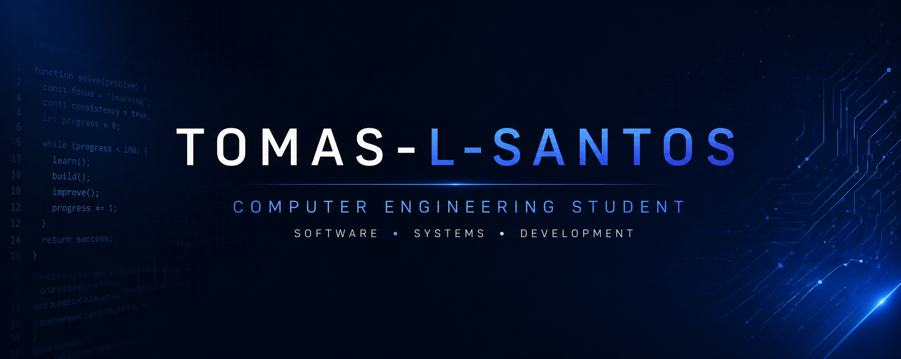

  

---

---

---

## About Me

I am a Computer Engineering student focused on building practical, real-world systems that are both functional and well-designed. I approach projects with a structured mindset, ensuring that requirements, system design, and implementation are aligned rather than treated as separate steps.

I focus on creating solutions that are not only functional, but clean, maintainable, and scalable. I take ownership of my work from initial concept through to final delivery, with strong attention to detail and consistency across all stages of development.

### Strengths

- Translating ideas into structured, working systems  
- Designing clean and consistent user interfaces  
- Maintaining organised projects (documentation, Git workflows, system modelling)  
- Problem-solving through a practical, iterative approach  
- Critically evaluating tools, including AI, rather than relying on them blindly  

I have hands-on experience with HTML, CSS, JavaScript, TypeScript, Kotlin, and MATLAB, and I am continuously developing my skills in full-stack development, system design, and real-world application building.

---

## Featured Projects

---

### [Student Life Manager](https://github.com/Tomas-l-santos/Student-Life-Manager)

A collaborative student productivity platform designed to centralise academic planning, including tasks, deadlines, timetables, modules, and budgeting.

**Built With:**

- HTML
- CSS
- JavaScript
- React

**Key Focus:**

- Requirements engineering and UML/system modelling
- Responsive frontend design and development
- Git/GitHub collaboration and version control

---

### [Concert Ticket App (Android – Kotlin)](https://github.com/Tomas-l-santos/ConcertTickets)

A mobile application built using Kotlin in Android Studio, designed to replicate a real-world ticket booking system.

**Key Focus:**
- Structured UI design and navigation flows  
- User interaction and app usability  
- Scalable layout and component organisation  

---

### [Real-Time Sensor Monitoring System](https://github.com/Tomas-l-santos/Sensors-Network-Assignment)

An IoT-based system that collects live sensor data using Arduino and streams it to a web dashboard for real-time visualisation.

**Built With:**
- Arduino (sensor data collection)  
- Python (Flask & Socket.IO backend)  
- Web dashboard for real-time data display  

**Key Focus:**
- End-to-end system integration (hardware → backend → frontend)  
- Real-time data processing and communication  
- Practical application of networking and embedded systems  

---

## Contact

- GitHub: https://github.com/Tomas-l-santos  

---

I am continuously building and refining projects that reflect real-world engineering practice.  
If you're interested in systems design, real-time applications, or practical software engineering, feel free to explore my work.